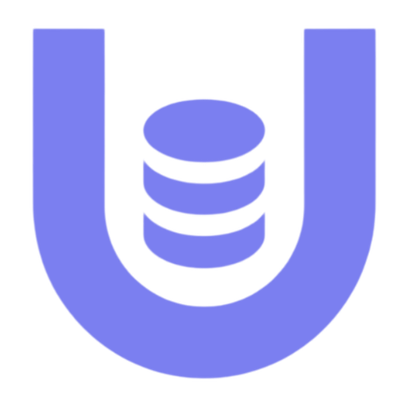

#  UniBase

UniBase is a self-hosted web client for several databases at once. One Go server holds the drivers and serves an Angular app, so you can browse and query PostgreSQL, Microsoft SQL Server, MySQL, MongoDB and Redis from a single browser tab.

## 🚀 Key Features

- **One workspace, five engines**: PostgreSQL, SQL Server, MySQL, MongoDB and Redis, each with its own object explorer.
- **"Ink & Engine" design**: dark and light themes, an indigo brand and IBM Plex + JetBrains Mono type. Each engine has its own color stripe, so you always see which database you are working in.
- **Environment tags**: mark connections as Local, Dev, Staging or Prod. Prod connections get a red striped border and ask for confirmation before `UPDATE`, `DELETE`, `DROP`, `ALTER` and other write statements.
- **SQL editor**: Monaco editor that runs the selection or the whole script (`GO` batches supported). Long queries can be cancelled, and each query stops after 10 minutes.
- **Results grid**: every result set in its own tab, columns sized to their content, row numbers, NULLs marked, readable GUIDs and binary values. Each result set is capped at 1,000 rows, with a note when it hits the cap.
- **MongoDB browser**: filter, sort, projection and paging with Compass-style input (`ObjectId()`, `ISODate()`). Documents show their BSON types, and edits keep arrays, dates, ObjectIds and number types unchanged.
- **Redis key editor**: view and edit strings, hashes, lists, sets and sorted sets. A key keeps its type and expiry when you save it, and a rename never overwrites an existing key.
- **Fast and safe connections**: shared connection pools, real driver error messages, passwords with special characters supported, and sessions kept in memory only.

---

## 🏁 Getting Started

### Prerequisites

- **Node.js**: v20.19 or higher (required by Angular 20)
- **Go**: v1.25 or higher
- **Angular CLI**: v20.3.x (`npm install -g @angular/cli@20.3.10`)

### Installation & Running

1. **Clone the Repository**

   ```bash
   git clone https://github.com/dev-mahmoudhamed/UniBase.git
   cd UniBase
   ```

2. **Launch the Application**

   The launch scripts build the frontend and then serve the whole app from the Go backend.

   **On Windows** (PowerShell):

   ```powershell
   ./run.ps1
   ```

   **On macOS/Linux:**

   ```bash
   ./run.sh
   ```

   Then open `http://localhost:5000` and add your first connection.

### Configuration

- UniBase listens on `127.0.0.1:5000` only, because it holds database credentials and has no login. To expose it on purpose, set `UNIBASE_ADDR`, for example `UNIBASE_ADDR=0.0.0.0:5000`.
- Sessions live in server memory and expire after 24 hours of no use. After a server restart the app reconnects on its own.
- Saved connections, including their passwords, are stored in your browser's local storage.

---

## 🧪 Development

Run the backend and the Angular dev server separately (the dev server proxies `/api` to the backend):

```bash
cd backend && go run main.go
```

```bash
cd frontend && npm start
```

Run the backend tests:

```bash
cd backend && go test ./...
```

### Test databases with Docker

Quick throwaway servers for local testing. Replace `<password>` with your own password.

```bash
docker run -d --name unibase-mssql -e ACCEPT_EULA=Y -e "MSSQL_SA_PASSWORD=<password>" -p 1433:1433 mcr.microsoft.com/mssql/server:2022-latest
```

```bash
docker run -d --name unibase-postgres -e POSTGRES_PASSWORD=<password> -p 5432:5432 postgres:latest
```

```bash
docker run -d --name unibase-redis -p 6379:6379 redis:latest redis-server --requirepass <password>
```

```bash
docker run -d --name unibase-mongo -p 27017:27017 mongo:8.2
```

---

## 📄 License

This project is licensed under the MIT License.
